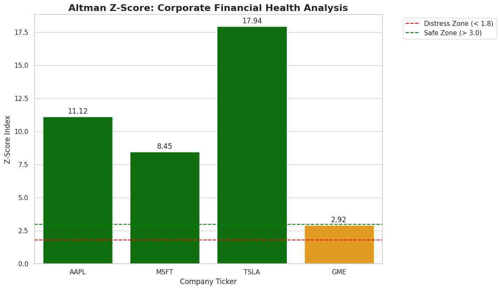

# Corporate Solvency Screening with the Altman Z-Score

A Python notebook that pulls the latest annual balance sheet and income statement for a list of public companies, computes the Altman Z-Score for each, and classifies them as safe, grey zone or distressed.

It automates a calculation a credit or financial analyst would otherwise do by hand in a spreadsheet: change the ticker list, run the notebook, and get the ratios, the score and a chart.



## Result

| Company | Z-Score | Zone |
| :--- | ---: | :--- |
| Tesla (TSLA) | 17.94 | Safe |
| Apple (AAPL) | 11.12 | Safe |
| Microsoft (MSFT) | 8.45 | Safe |
| GameStop (GME) | 2.92 | Grey |

Scores reflect the statements and market prices Yahoo Finance returned on the day the notebook was run, and will change when it is re-run.

Two things stand out. GameStop sits just under the 3.0 line, so a modest move in its share price would shift its zone. And the three large technology companies score far above the safe threshold mainly because of ratio D: their market value is many times their liabilities. Tesla's 17.94 says more about its valuation than about its balance sheet.

## The model

`Z = 1.2A + 1.4B + 3.3C + 0.6D + 1.0E`

| | Ratio | Measures |
| :--- | :--- | :--- |
| A | Working capital / total assets | Liquidity |
| B | Retained earnings / total assets | Cumulative profitability |
| C | EBIT / total assets | Operating efficiency |
| D | Market capitalization / total liabilities | Market cushion over debt |
| E | Sales / total assets | Asset turnover |

Above 3.0 is the safe zone, below 1.8 is the distress zone, and between the two is the grey zone.

## How it works

1. `get_financial_metrics()` requests the most recent annual balance sheet, income statement and market capitalization for a ticker through the `yfinance` library.
2. The line items are assembled into a pandas DataFrame, one row per company.
3. The five ratios and the Z-Score are computed as new columns.
4. A bar chart colors each company by zone and draws the 1.8 and 3.0 thresholds.

A ticker that fails to download is reported and skipped, so one bad symbol does not stop the run.

## Limitations

- The original Z-Score was calibrated on manufacturers. It overstates the safety of asset-light technology companies and does not apply to banks or insurers. Altman's later Z'' variant is the better fit for non-manufacturers.
- Ratio D depends on the share price, so the score moves with the market even when the financial statements have not changed.
- Spirit Airlines (SAVE) was included as a distressed example, but Yahoo Finance no longer returned statements for it, so the sample has no company in the distress zone.
- Four companies is a demonstration, not a study. The next step would be a full sector with several years of scores per company.

## Running it

```bash
git clone https://github.com/thesjhu/corporate-solvency-analysis.git
cd corporate-solvency-analysis
pip install -r requirements.txt
jupyter notebook corporate_solvency_analysis.ipynb
```

An internet connection is needed, since the data comes from Yahoo Finance at run time.

## Author

Sijie Hu, MS Information Systems (Data Analytics), Baruch College. [LinkedIn](https://linkedin.com/in/thesjhu)
